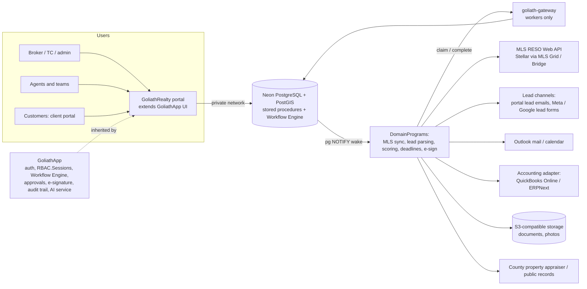

# GoliathRealty

GoliathApp specialization for real estate brokerages: listings, leads, showings, offers and transactions with broker compliance review, the escrow/trust ledger, commission plans and agent licensing, AI-assisted lead collection from sanctioned channels, and a client portal. Initial targets are small independent Florida brokerages (roughly 3–40 agents) under FREC rules.

Status: **planned**. This repository currently holds the catalog entry and the plan.

Interactive plan page: [GoliathRealty — Real Estate plan](https://cursor.com/canvas/store-64fbaa6f-ccac-43dd-bc98-ccd6a79ed7de/bf66768d-8058-4651-b489-4634df4e6033)

## Layout

| Path | Purpose |
| --- | --- |
| [`docs/plan.md`](docs/plan.md) | Full plan: roles, modules, lead collection, domain model, workflows, DomainPrograms, schema, integrations, compliance, competitors, roadmap, risks, decisions |
| [`.goliath/product.json`](.goliath/product.json) | GoliathWeb catalog entry |

## Architecture

GoliathRealty inherits GoliathApp auth (`RBAC.Sessions`), the portal, the semantic registry (named requests + Exograph GraphQL/MCP) as the read API, typed `ActionSpec` actions, the Workflow Engine, and workers that claim tasks through goliath-gateway, with Postgres pub/sub waking workers for event-triggered tasks. Human approval steps, e-signatures, the audit trail, inbound email ingestion and the AI scoring/draft service are generic GoliathApp features; accounting syncs through the shared pluggable adapter.

See the [plan](docs/plan.md) for details.

## Related

| Product | Role |
| --- | --- |
| [GoliathApp](https://github.com/Goliath-Research/GoliathApp) | Platform (RBAC, portal shell, Workflow Engine, workers, DomainPrograms) |
| [GoliathFactory](https://github.com/Goliath-Research/GoliathFactory) | Sibling application; shared accounting adapter |
| [GoliathWeb](https://github.com/Goliath-Research/GoliathWeb) | Public catalog (product page) |

## License

MIT — Copyright 2026 Goliath Research.
