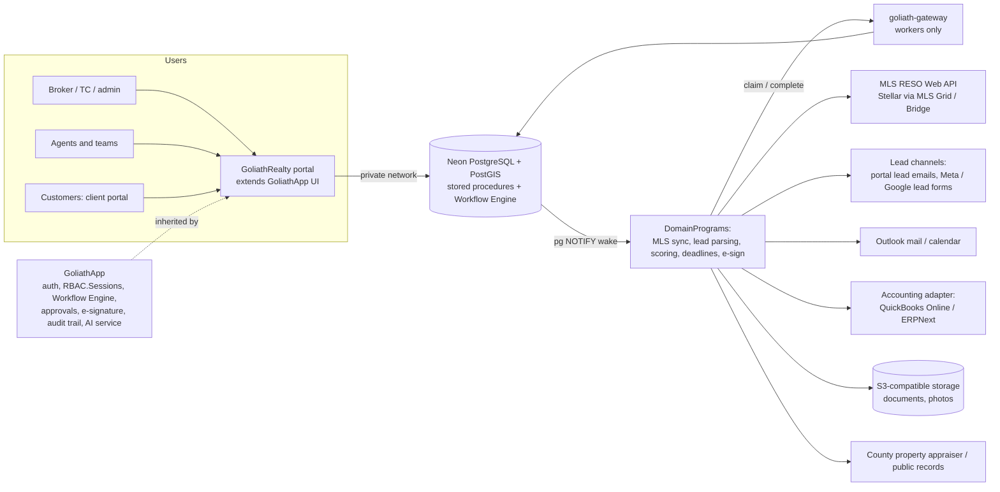

# GoliathRealty — Real Estate plan

GoliathRealty is a GoliathApp child app that runs a small Florida brokerage: broker compliance and escrow, agent CRM and transactions, AI-assisted lead collection, and a client portal. Phase 0 is one pilot brokerage, not code.

Interactive version: [GoliathRealty — Real Estate plan](https://cursor.com/canvas/store-64fbaa6f-ccac-43dd-bc98-ccd6a79ed7de/bf66768d-8058-4651-b489-4634df4e6033)

## Vision and buyer

One system for an independent brokerage: listings, leads, showings, offers through closing, broker compliance review, escrow ledger and commissions, with every agent, broker and client action typed, signed and recorded.

| Buyer | Detail | Priority |
| --- | --- | --- |
| Small independent Florida brokerages | Roughly 3–40 agents, owner is the managing broker, today stitching together a CRM, Dotloop/SkySlope, spreadsheets for splits and a bank ledger for escrow | Primary |
| Teams inside larger brands | Team leaders needing lead routing and splits; constrained by the franchise's mandated stack | Secondary |
| Not the buyer | Franchise or 200+ agent brokerages already locked into enterprise suites (kvCORE/BoldTrail, Lone Wolf) | — |

The pitch: Florida rules built in (brokerage relationship disclosures, 3-business-day escrow deposit, monthly reconciliation, FAR-BAR deadlines) at a cost a small broker can carry.

## Architecture fit

| Aspect | Decision |
| --- | --- |
| Parent | GoliathApp (knows nothing about GoliathRealty) |
| Auth | Inherit GoliathApp auth and `RBAC.Sessions`; clients are external users with a scoped role |
| API | Neon PostgreSQL stored procedures; portal connects over private network |
| Workflows | GoliathApp Workflow Engine (IF/SWITCH/WHILE, WAIT_EVENT); human approval steps, e-signature, audit trail and pending-tasks API are planned GoliathApp features, not built here |
| Shared modules | Accounting adapter from the GoliathFactory plan (QuickBooks Online first, ERPNext free); inventory/purchasing module not used |
| Workers | Claim through goliath-gateway only; Postgres pub/sub wakes event tasks |
| Geo | PostGIS for listing search, map polygons, saved-search areas |
| Defaults | Florida jurisdiction; free/open tools first; CPU-only workers |
| Status | planned |

## Users and roles

| Role | Can |
| --- | --- |
| Broker (owner / managing broker) | Everything; compliance approval, escrow disbursement, commission plans, user and license admin |
| Office admin | Users, onboarding, document templates, reports; no escrow disbursement |
| Transaction coordinator | Run checklists and deadlines on assigned transactions, collect documents, submit for review |
| Team leader | Route leads and see pipeline for own team; team split rules |
| Agent | Own leads, listings, showings, offers, transactions; submit docs for review |
| Bookkeeper | Escrow entries, reconciliations, commission disbursements, accounting sync |
| Client: buyer / seller / landlord / tenant | Client portal for own deals only: timeline, documents, signing, messages, saved searches |
| Cooperating agent / vendor (guest) | Time-limited link to upload or view specific documents |
| Worker (service) | Gateway claim scopes only |

Row-level security by office, team, agent and client. A client never sees another party's confidential notes (transaction-broker limited confidentiality).

## Core modules

| Module | What it covers |
| --- | --- |
| Listings and intake | Listing agreement intake, property facts, photos, showing instructions, broker approval before going live, MLS input checklist; status history |
| CRM and leads | Contacts, households, sources, notes, tasks, reminders; lead routing (round-robin, by area/price/language, pond for unclaimed leads) |
| Showings | Requests, confirmations, feedback; blocks a tour until a signed buyer agreement exists |
| Offers and transactions | Offers/counters, contract dates, FAR-BAR deadline calendar (escrow deposit, inspection, financing, appraisal, title, closing), checklists by transaction type |
| Documents and e-sign | Templates, upload, versioning, e-signature via the GoliathApp service; external providers optional |
| Broker compliance review | Required-document checklist per transaction; approve/reject with comments; closing blocked until approved |
| Escrow / trust ledger | Per-transaction deposits and disbursements, receipt timing, monthly three-way reconciliation, conflicting-demand tracking |
| Commissions and agent billing | Splits, caps, tiered and team splits, referral fees, transaction/desk fees; disbursement authorization; agent statements; 1099 data to accounting |
| Agent onboarding and licensing | Onboarding checklist, license number and expiry, CE hours, renewal reminders, MLS/association memberships, E&O |
| AI-assisted lead collection | Sanctioned portal lead ingestion, public-data prospecting, AI dedup/scoring/drafts, routing (below) |
| Property management (later) | Rentals, leases, tenant ledger, security deposits in PM escrow, maintenance requests, owner statements |
| Reporting | Pipeline, GCI, closed volume, lead source ROI, agent production, cap progress, escrow aging, compliance backlog |

## AI-assisted lead collection

Collect every lead the brokerage is entitled to, from every channel it already pays for or that is public, into one deduplicated, scored queue. Agents always review and send; nothing contacts a consumer automatically.

**Out of scope: scraping Zillow, Redfin, Realtor.com.** All three Terms of Use forbid it. Zillow bans automated queries including scraping, crawlers and captcha bypass. Redfin (section 2.3.5) bans automated crawling or querying without written permission. Realtor.com bans scraping and automated collection, bans using its content for AI/LLM purposes, and states robots.txt grants no extra rights. Scraping risks account termination, legal claims and the broker's MLS/portal standing.

### 1. Sanctioned channel connectors

| Channel | How leads arrive |
| --- | --- |
| Zillow Premier Agent / Flex | Two-way CRM sync currently only for listed partners (Follow Up Boss, Top Producer, Lofty); apply as an integration partner later; until then parse Zillow lead-notification emails |
| Realtor.com Connections Plus / Market Reach | API delivery to approved CRMs; otherwise lead-notification emails |
| Redfin Partner Agent | Referral-fee program in markets Redfin does not staff; referral leads by email/partner portal |
| Homes.com and other portals | Lead-notification emails; API if the portal offers a CRM program (confirm) |
| Facebook / Instagram Lead Ads | Meta Lead Ads webhooks and Graph API, with consent text captured on the form |
| Google lead forms / Local Services Ads | Google Ads lead form webhook; LSA leads via API (confirm availability) |
| Own IDX site and portal | Native forms with TCPA/FTSA-compliant consent checkbox |
| Lead-notification emails (any source) | Outlook inbox rule or forwarding address; parser per sender template, AI fallback for unknown templates |

### 2. Public-data prospecting

| Source | Use and limits |
| --- | --- |
| Expired / withdrawn / canceled listings | From the licensed MLS feed only, within the license's permitted use; check Stellar rules on soliciting expireds |
| FSBO | Signs and posts read by an agent; owner contact only from public records; no portal scraping |
| County property appraiser records | Free bulk downloads in many Florida counties: owner, mailing vs situs address (absentee owners), sale dates, homestead flag |
| Probate and lis pendens / pre-foreclosure | County clerk public filings where published; mail-first, compassionate templates, broker approval of campaigns |
| Phone and email for prospects | No purchased data in v1 (see decisions) |

Controls:

- Scrub prospect phone numbers against the National DNC Registry and the Florida DNC list before any call (refresh interval to confirm; commonly 31 days).
- No autodialer, prerecorded voice or automated texts to prospects without prior express written consent (TCPA; Florida FTSA, s. 501.059, as amended 2023).
- Calling-hour and call-frequency limits per FTSA (to confirm with counsel).
- CAN-SPAM for email: real sender, postal address, working opt-out.
- Fair housing: no targeting or scoring on protected classes or proxies.

### 3. AI layer

- **Entity resolution:** merge the same person across portal emails, Meta forms, IDX signups and public records; human confirm on low-confidence merges.
- **Lead scoring and intent:** portal activity in the payload, IDX views and saved searches, responses, stated timeline, absentee/equity facts; explainable and audited for fair housing.
- **Enrichment:** property facts from public records and MLS; never infer protected traits.
- **Suggested first message:** drafted for the assigned agent, channel chosen by consent and DNC status; the agent edits and sends. Never auto-sent.
- **Routing:** Workflow Engine SWITCH by area, price, language, source → assign → WAIT_EVENT accept → reassign on timeout.

| Piece | Lives in |
| --- | --- |
| Inbound email ingestion (Outlook/Graph mailbox, parsing framework) | GoliathApp (generic) |
| AI scoring / LLM draft service, entity-resolution engine, consent and suppression registry | GoliathApp (generic) |
| Portal-specific parsers, real-estate scoring features, DNC/FTSA rules pack, prospect lists | GoliathRealty |

## Customer portal

- **Saved searches:** map/polygon and criteria searches over IDX-licensed listings; new-match email alerts.
- **Transaction timeline:** milestones and deadlines in plain language; what is due from the client next.
- **Documents and signing:** agreements, disclosures, contract, closing docs; sign in place.
- **Messages:** threaded with the agent and TC, stored with the transaction.
- **Landlord / tenant (later):** rent ledger, maintenance requests, lease documents.

## Domain model

| Entity | Key facts |
| --- | --- |
| Brokerage / office / team | License numbers, escrow accounts, team membership and leader |
| Agent | License type and number, expiry, CE hours, commission plan, MLS IDs |
| Contact / client | Person or entity, roles per deal, consent and communication preferences |
| Brokerage relationship | Transaction broker / single agent / no brokerage; disclosure doc and date; transitions with consent |
| Buyer agreement | Signed date, term, compensation amount or rate, negotiable statement; required before tours |
| Property | Parcel ID, address, geometry (PostGIS), facts, public-record links |
| Listing | Listing agreement, price history, MLS number, status, showing instructions |
| Lead | Source, routing history, assignee, stage |
| Lead source / raw lead | Channel, payload, received time, parser version, consent evidence |
| Prospect | Public-data origin (appraiser, clerk, MLS expired), property link, suppression flags |
| Consent / suppression | Per phone/email: consent text, time, source; DNC check date; opt-outs (GoliathApp registry) |
| Lead score / draft | Score, explanation, model version; draft and agent edit/send record |
| Showing | Property, agent, client, time, feedback |
| Offer / transaction | Parties, price, contract form, effective date, deadlines, checklist, stage |
| Document / signature | Template, version, signer, meaning, time (GoliathApp service) |
| Escrow ledger entry | Account, transaction, amount, received/deposited dates, disbursement authorization |
| Commission plan / disbursement | Split rules, caps, fees; per-closing calculation and payout lines |
| Audit trail | Append-only (GoliathApp) |

## Workflows on the Workflow Engine

| Workflow | Typed actions |
| --- | --- |
| Offer-to-close | Offer accepted → open transaction → escrow deposit due (WAIT_EVENT) → inspection period → IF financing contingency: appraisal/loan approval steps → broker compliance review (human approval) → closing → commission disbursement approval → close file |
| Conditional approvals | IF price above threshold, OR agent in probation, OR conflict → broker approval step; ELSE auto-advance |
| Listing intake | Agreement signed → docs complete → broker approves → MLS input → go-live |
| Buyer onboarding | Lead → relationship disclosure → buyer agreement signed (gate for showings) |
| Escrow deposit | Received by agent → to broker by end of next business day → deposited within 3 business days; overdue escalates |
| Monthly reconciliation | Bank statement import → three-way match → broker signs reconciliation |
| Conflicting demands | Dispute flagged → FREC notice within 15 business days → resolution path |
| Agent onboarding | Invite → license verify → plan assignment → MLS/association → training ack |
| License renewal | WHILE not renewed: reminders 90/60/30 days before expiry → broker alert at expiry |
| Lead routing | SWITCH on rule → assign → WAIT_EVENT accept within N minutes → else reassign |

## Workers and DomainPrograms

| Program | Activation | Trigger |
| --- | --- | --- |
| MLS RESO sync (replication) | Claim | Scheduled; incremental by ModificationTimestamp |
| Saved-search match alerts | Wake + claim | New/changed listings ingested |
| Deadline scan | Claim | Hourly backlog |
| Escrow timing alert | Wake + claim | Deposit received, not deposited |
| License / CE renewal scan | Claim | Daily backlog |
| Outlook mail / calendar sync | Claim | Scheduled |
| Accounting adapter sync | Claim | Disbursement approved |
| Document render / e-sign packaging | Wake + claim | Signing request created |
| Public records lookup | Wake + claim | Property created |
| Lead email parser | Wake + claim | Lead-notification email arrives |
| Lead webhook intake (Meta / Google) | Wake + claim | Webhook stored by stored procedure |
| Entity resolution and scoring | Wake + claim | Raw lead or prospect inserted |
| First-message draft | Wake + claim | Lead assigned |
| DNC scrub and prospect refresh | Claim | Weekly backlog |

Same pattern as GoliathCrop and GoliathFactory: a stored procedure inserts the task and issues `pg_notify`; idle workers wake, then own it with a gateway claim. All CPU-only.

## Database schema sketch

| Schema | Key tables |
| --- | --- |
| `re_org` | offices, teams, agents, licenses, ce_records, memberships |
| `re_crm` | contacts, households, leads, lead_routes, activities, tasks |
| `re_lead` | lead_sources, raw_leads, prospects, lead_matches, lead_scores, message_drafts, prospect_lists, dnc_checks |
| `re_prop` | properties (PostGIS geometry), listings, listing_media, price_history, mls_listings (RESO replica) |
| `re_deal` | relationships, buyer_agreements, showings, offers, transactions, deadlines, checklist_items |
| `re_doc` | templates, documents, document_versions, review_decisions |
| `re_trust` | escrow_accounts, ledger_entries, reconciliations, disputes |
| `re_comm` | commission_plans, plan_rules, caps, disbursements, agent_charges, statements |
| `re_portal` | client_access, saved_searches, messages |
| `re_pm` (later) | rentals, leases, tenant_ledger, maintenance_requests, owner_statements |
| `re_api` | stored procedures only; the portal's surface |

## Integrations

- **MLS / RESO Web API:** Stellar MLS delivers through MLS Grid or Bridge API (RESO Data Dictionary). Needs a three-party agreement (broker, vendor, MLS) and a working product; MLS Grid offers a demo feed. Published Stellar fees: broker back-office or VOW feed $450 per office per year (capped at $7,500); vendor product $7,500 per year plus $2,500 per additional product. Space Coast and other local MLSs: access route unknown, confirm per pilot.
- **IDX website:** public search on the brokerage domain under IDX display rules; VOW only if needed.
- **E-signature:** GoliathApp service for internal docs; integrate the broker's existing FAR-BAR signing tool for contracts.
- **Florida Realtors / FAR-BAR forms:** member-licensed; stored and tracked, never redistributed.
- **Outlook mail and calendar:** Microsoft Graph for email logging, lead-email ingestion, showing and deadline events.
- **Lead channels:** portal lead emails via Outlook; Realtor.com and Zillow APIs once partner-approved; Meta Lead Ads and Google lead forms via webhooks. No portal scraping.
- **Do Not Call:** National DNC Registry (FTC) and Florida DNC list (FDACS).
- **Accounting adapter:** shared with GoliathFactory: QuickBooks Online first, ERPNext free option; commission payouts, fees, 1099 data. Escrow stays in its own ledger.
- **Maps / PostGIS:** OpenStreetMap tiles and free geocoding (Nominatim / US Census geocoder).
- **Public records:** county property appraiser data (many Florida counties publish free downloads) and Florida DOR parcel data; coverage varies by county.

## Architecture diagram

## Compliance and privacy

| Area | Built-in control |
| --- | --- |
| Brokerage relationships (F.S. 475.278) | Transaction broker presumed unless single agent or no brokerage is in writing; dual agency not allowed; single-agent disclosure before showing or agreement; consent captured on transition |
| Escrow (F.S. 475.25(1)(k), FAC 61J2-14) | Agent to broker by end of next business day; broker deposits within 3 business days; monthly reconciliation; broker-funds limits ($1,000 sales, $5,000 PM escrow); conflicting demands to FREC within 15 business days |
| NAR settlement (effective 17 Aug 2024) | Written buyer agreement before any tour with objectively ascertainable compensation, cap on compensation from any source, negotiable-commission statement; no compensation fields from MLS data |
| Telemarketing (TCPA, Florida FTSA s. 501.059) | Prior express written consent for automated calls/texts (2023 amendment: checkbox or affirmative reply counts); National and Florida DNC scrubbing; FCC one-to-one consent rule vacated and removed in 2025; CAN-SPAM for email |
| Fair housing | No search filters or lead scoring on protected classes; ad copy review prompts; routing rules logged |
| Licensing | Track license expiry and CE; block assignment of unlicensed users to deals |
| Privacy and retention | Marketing consent recorded; client data scoped per deal; keep transaction and escrow records at least 5 years (FAC 61J2-14.012, confirm), then archive |

Not legal advice: the pilot broker and an attorney sign off on each control before go-live.

## Competitors and positioning

| Product | Strength | Gap for a small Florida brokerage |
| --- | --- | --- |
| kvCORE / BoldTrail | IDX sites, lead gen, CRM | No escrow ledger; enterprise pricing and setup |
| Lone Wolf / brokerWOLF | Back office, commissions, trust accounting | Legacy UX; separate products to stitch |
| SkySlope | Transaction management, compliance review | Little CRM or commissions depth |
| Dotloop (Zillow) | E-sign and loops, agent familiarity | Light broker compliance; no ledger |
| Follow Up Boss | Lead CRM and routing | No transactions, escrow or commissions |
| Zillow Premier Agent / Flex tools | Buyer leads plus Premier Agent app | Leads only, referral-style economics; locked to Zillow's CRM partners |
| REDX | Expired, FSBO and pre-foreclosure lists with dialer | Prospecting only; dialer use is the broker's TCPA risk |
| Vulcan7 | Expired/FSBO data and dialer | Prospecting only; no back office |
| PropStream | Public-record property data and lists | Investor-focused; no lead-to-close workflow |

Positioning: one Florida-native system replacing 3–4 subscriptions, integrating with Dotloop or Follow Up Boss where agents insist. Competitor prices are not listed; get current quotes before any pitch.

## Roadmap

1. **Phase 0 — Find the pilot (no code).** Interview 5–10 Florida brokers; pick one; map tools, checklists, escrow and splits; agree v1 scope and a discounted first-buyer build (never free).
2. **Phase 0b — GoliathApp prerequisites.** Human approval step, e-signature service, generic audit trail, pending-tasks API, external (client) user role, inbound email ingestion, AI scoring/draft service.
3. **Phase 1 — Repo and core data.** Org, agents, contacts, properties, transactions schemas shaped by the pilot.
4. **Phase 2 — MVP.** Transactions with checklists and deadlines, broker compliance review, documents and e-sign, buyer-agreement gate, escrow ledger, licensing tracking, client portal timeline.
5. **Phase 3 — Money, CRM and lead ingestion.** Commissions, caps, agent billing, accounting adapter; CRM, lead routing, Outlook sync; lead-email parsing, Meta/Google webhooks, dedup, scoring, agent-reviewed drafts.
6. **Phase 4 — MLS, IDX and prospecting.** RESO sync, saved searches, IDX site, listing intake to MLS; public-data prospecting with DNC/FTSA controls; portal API partnerships if approved.
7. **Phase 5 — Property management and beyond.** Rentals, leases, PM escrow, owner statements; second brokerage; other states as jurisdiction packs.

Pilot criteria:

- [ ] Independent Florida brokerage, 3–40 agents, broker decides
- [ ] Real pain (audit finding, escrow scare, split spreadsheet errors)
- [ ] Stellar MLS member willing to sign the three-party data agreement
- [ ] Pays a discounted first-buyer build (never free) and agrees to be a reference
- [ ] Within driving distance in Florida

## Risks

- **Building for nobody:** no code before a signed pilot.
- **MLS data access and cost:** start on the pilot broker's own feed; the MVP does not depend on MLS.
- **Legal / compliance liability:** controls are aids; the broker remains responsible; attorney review.
- **TCPA / FTSA litigation:** FTSA has a private right of action; no automated calls/texts without written consent; DNC enforced in code; consent evidence stored.
- **Portal ToS and partner access:** Zillow/Realtor.com APIs are partner-gated; email parsing until approved; scraping stays out of scope.
- **AI bias and errors:** scoring audited for fair-housing proxies; drafts always human-reviewed; model versions logged.
- **Agent adoption:** integrate with Dotloop/FUB first, replace later.
- **Forms licensing:** FAR-BAR forms are not bundled.
- **Scope creep:** stay on broker operations, not ad buying or website building.

## Decisions

All 15 recommended defaults were adopted by David on 2026-11-03.

| # | Question | Decision |
| --- | --- | --- |
| 1 | First pilot brokerage and introducer | Any independent Florida broker who answers first; does not change the plan |
| 2 | Pilot commercial shape | Discounted build for the first buyer, never free |
| 3 | MVP without MLS feed? | Yes: MVP is transactions, compliance, escrow, commissions; MLS in Phase 4 |
| 4 | Which MLS first | Stellar MLS via the pilot broker's back-office feed ($450/office/yr) through Bridge or MLS Grid; vendor product license only at 2+ brokerages |
| 5 | E-sign: own or integrate | GoliathApp e-signature for internal docs; integrate the broker's existing FAR-BAR signing tool for contracts |
| 6 | Escrow: hold or track | Track ledger and reconciliations only; money stays in the broker's bank, no payment processing |
| 7 | Accounting | Shared adapter: QuickBooks Online first, ERPNext free option |
| 8 | CRM: replace or integrate Follow Up Boss | Integrate if the pilot uses it; native CRM in Phase 3 |
| 9 | Property management scope | Later phase, only if the pilot manages rentals |
| 10 | Other states | Florida only until two Florida customers; then jurisdiction packs |
| 11 | Client portal login | Magic-link email login via GoliathApp external user role |
| 12 | Name | GoliathRealty (id `goliathrealty`) |
| 13 | Phone outreach to prospects | Manual click-to-call only after DNC scrub; no autodialer or automated texts in any phase |
| 14 | Skip-trace / paid contact data | Not in v1; public records plus the broker's own leads; add a licensed vendor only if the pilot asks and pays |
| 15 | LLM for scoring and drafts | GoliathApp AI service with a low-cost hosted model; send only minimum lead fields; no portal content used for training |

## Sources

- NAR, Written buyer agreements 101: https://www.nar.realtor/the-facts/written-buyer-agreements-101
- F.S. 475.278: https://www.flsenate.gov/Laws/Statutes/2025/475.278
- Florida Realtors, escrow laws and rules: https://www.floridarealtors.org/law-ethics/library/florida-escrow-laws-rules
- Stellar MLS data delivery: https://www.stellarmls.com/data-delivery
- MLS Grid FAQ: https://www.mlsgrid.com/faq
- Zillow Terms of Use: https://www.zillow.com/corporate/terms-of-use/
- Redfin Terms of Use: https://www.redfin.com/about/terms-of-use
- Realtor.com Terms of Use: https://www.realtor.com/terms-of-use/
- Zillow Premier Agent CRM integrations FAQ: https://www.zillow.com/premier-agent/crm-integrations-faq/
- Follow Up Boss, lead sources and inbox processing: https://help.followupboss.com/hc/en-us/articles/4420151624343-Lead-Sources-Websites-with-API-Integrations
- Florida FTSA 2023 amendment (Goodwin): https://www.goodwinlaw.com/en/insights/publications/2023/06/alerts-otherindustries-dpc-florida-amends-mini-tcpa
- FCC removes one-to-one consent rule: https://www.fcc.gov/document/fcc-removes-one-one-consent-rule-nullified-court-decision
